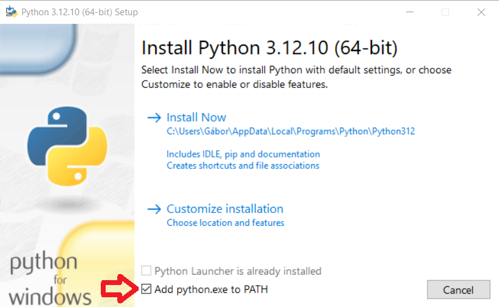
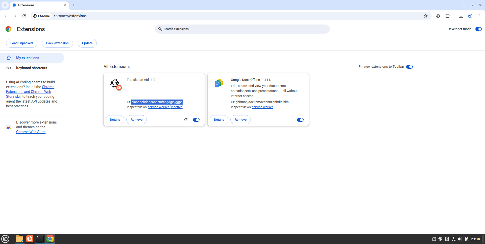
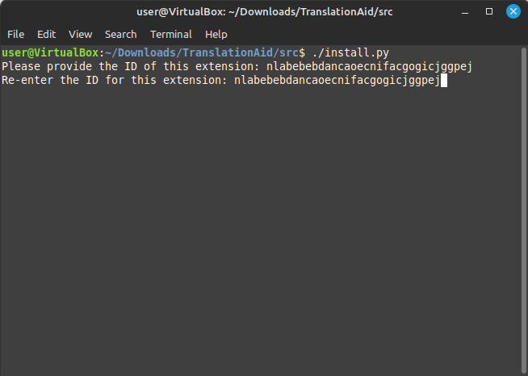

# Translation Aid


Translation Aid is a Google Chrome browser extension that displays translation services in a sidebar. It automatically translates text selected on web pages and shows the translation in the sidebar. It currently supports two translation services: Argos Translate and Google Translate.
## Contents
- [How does it work? (in a nutshell)](#how-does-it-work-in-a-nutshell)
- [Installing a Browser Extension](#Installing-a-Browser-Extension)
- [Installing a native script](#Installing-a-native-script)

## How does it work? (in a nutshell)
Translation Aid sends the text to be translated to a Python-based script via the [Chrome Native API](https://developer.chrome.com/docs/extensions/develop/concepts/native-messaging); the script then returns the translated content to the browser extension, which displays it. The script utilizes the [argostranslate](https://pypi.org/project/argostranslate/) and [googletrans](https://pypi.org/project/googletrans/) Python modules to perform the translation. In the case of Google Translate, the text is sent to Google’s servers, and the translation is received back from them; conversely, Argos Translate is installed on the local machine, meaning it performs translations locally. Consequently, the speed of translation depends on the computing power of the local machine.

## Installing a Browser Extension
### 1. Download Translation Aid
> [!WARNING]
> Download the Translation Aid folder to a path—or move the downloaded folder to a location—that contains only ASCII characters (i.e., only the letters and characters of the English alphabet).
>
> For example:
>
> :x: C:\\Users\\Ödön\\...\\TranslationAid
>
> :white_check_mark: C:\\Users\Odon\\...\\TranslationAid
 
Download Translation Aid using the `git clone` command:
```
git clone https://github.com/ihlet/TranslationAid.git
```
or (as shown in the image below) click the "Code" button on the main page of ihlet/TranslationAid, then select "Download ZIP".

### 2. Opening the extensions tab
Open the Chrome home screen, then click on the following:
```
menu (top right corner) -> Extension -> Manage Extensions
```

### 3. Enabling Developer mode
Turn on the "Developer mode" switch in the top-right corner!

### 4. Loading the extension
Click the "Load unpacked" button in the top-left corner, then locate the Translation Aid folder you downloaded in step 1 and select the "src" folder inside it!

## Installing a native script
For TranslationAid to be able to have the desired text translated, the script must be present for the browser's native API.
### Step 1: Installation on GNU/Linux
> [!IMPORTANT]
> A Python interpreter version 3.10 or later is required to install the script.

> [!NOTE]
> If you are using an Ubuntu-based distribution (e.g., Linux Mint), you must install the `python3-venv` package before launching the installer.
> ```
> sudo apt install python3-venv
> ```
Open a terminal and enter the following command:
```
cd <path/to/TranslationAid-folder/src>
chmod +x install.py
./install.py
```
### Step 1: Installation on Windows
To install and run the script, a Python interpreter (version 3.10 or later) is required. You can download the interpreter from [https://www.python.org/](https://www.python.org/).
> [!NOTE]
> Please install only one version! Having two or more versions of the interpreter installed can interfere with the operation of TranslationAid’s native script.

> [!IMPORTANT]
> Check the "Add python.exe to PATH" option in the Python installer!
> (It is marked with a red arrow in the image below.)
> 
>

After installing Python, navigate to the Translation Aid folder and double-click the install.bat file located in the "src" folder!
### Step 2: Specifying the extension identifier
The installer will ask for the extension ID. You can find it on the extensions page in the Chrome browser. (In the image below, the part you need to copy is highlighted in blue.)




