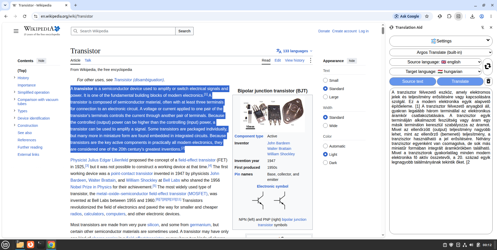
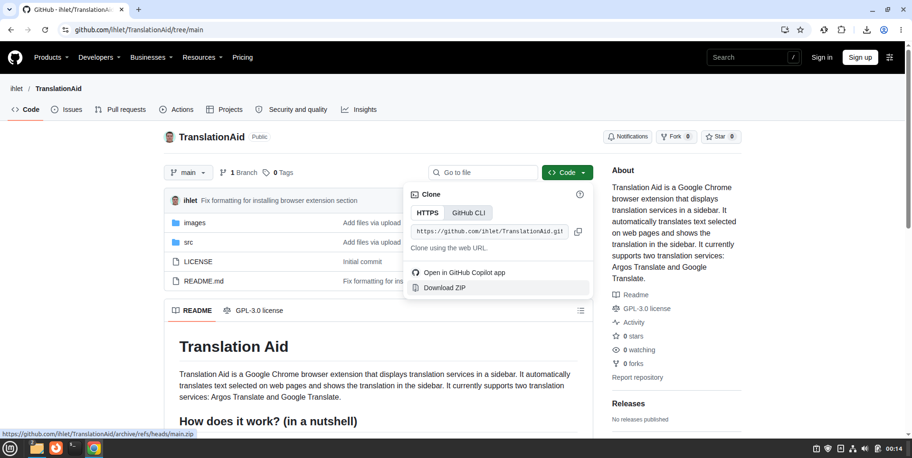
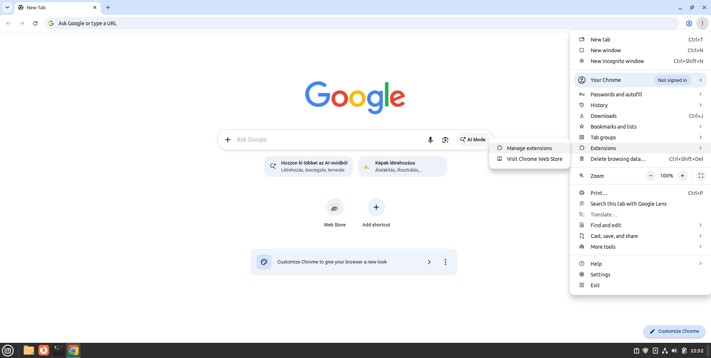
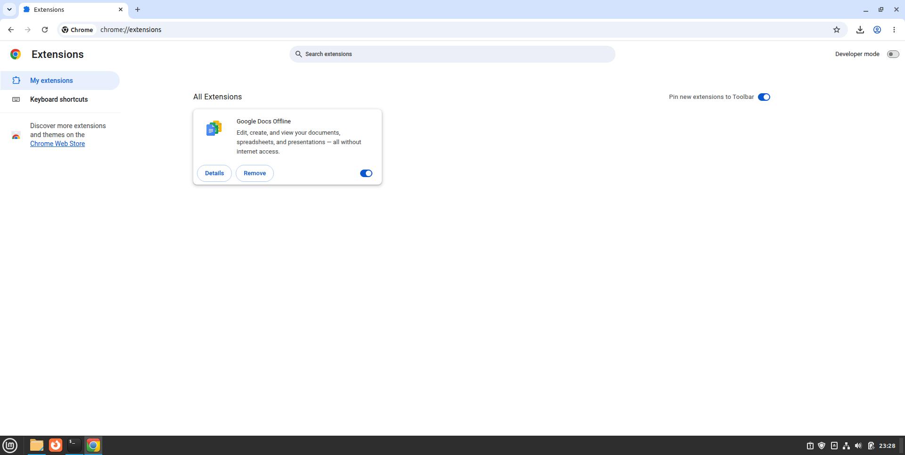
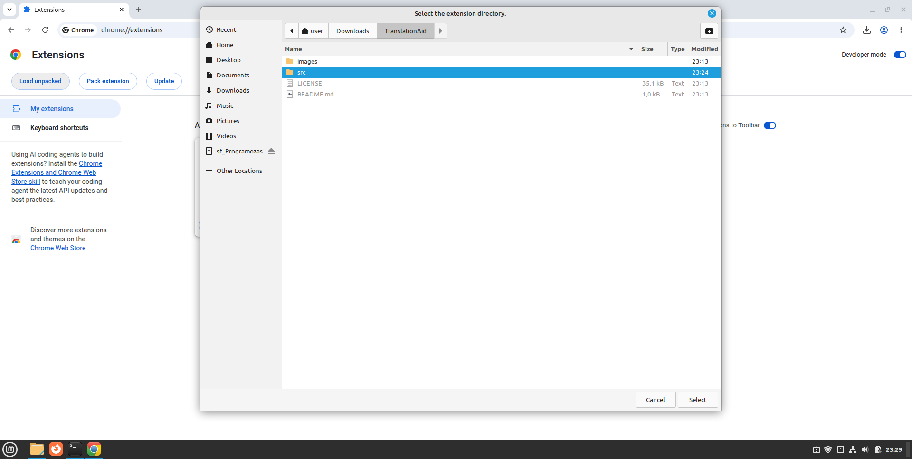

# Translation Aid


Translation Aid is a Google Chrome browser extension that displays translation services in a sidebar. It automatically translates text selected on web pages and shows the translation in the sidebar. It currently supports two translation services: Argos Translate and Google Translate.
## Contents
- [How does it work? (in a nutshell)](#how-does-it-work-in-a-nutshell)
- [Installing a Browser Extension](#Installing-a-Browser-Extension)

## How does it work? (in a nutshell)
Translation Aid sends the text to be translated to a Python-based script via the [Chrome Native API](https://developer.chrome.com/docs/extensions/develop/concepts/native-messaging); the script then returns the translated content to the browser extension, which displays it. The script utilizes the [argostranslate](https://pypi.org/project/argostranslate/) and [googletrans](https://pypi.org/project/googletrans/) Python modules to perform the translation. In the case of Google Translate, the text is sent to Google’s servers, and the translation is received back from them; conversely, Argos Translate is installed on the local machine, meaning it performs translations locally. Consequently, the speed of translation depends on the computing power of the local machine.

## Installing a Browser Extension
### 1. Download Translation Aid
> [!WARNING]
> Download the Translation Aid folder to a path—or move the downloaded folder to a location—that contains only ASCII characters (i.e., only the letters and characters of the English alphabet).

 For example
 :x: C:\Users\Ödön\...
 :white_check_mark: C:\Users\Odon\...
Download Translation Aid using the `git clone` command:
```
git clone https://github.com/ihlet/TranslationAid.git
```
or (as shown in the image below) click the "Code" button on the main page of ihlet/TranslationAid, then select "Download ZIP".

### 2. Opening the extensions tab
Open the Chrome home screen, then click on the following:
```
menu (top right corner) -> Extension -> Manage Extensions
```

### 3. Enabling Developer mode
Turn on the "Developer mode" switch in the top-right corner!

### 4. Loading the extension
Click the "Load unpacked" button in the top-left corner, then locate the Translation Aid folder you downloaded in step 1 and select the "src" folder inside it!

## Installing 

